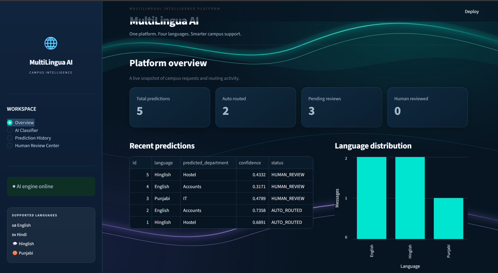
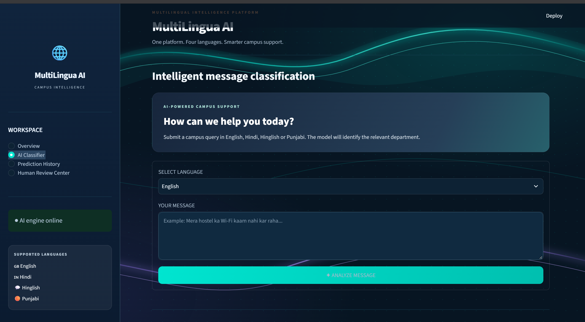
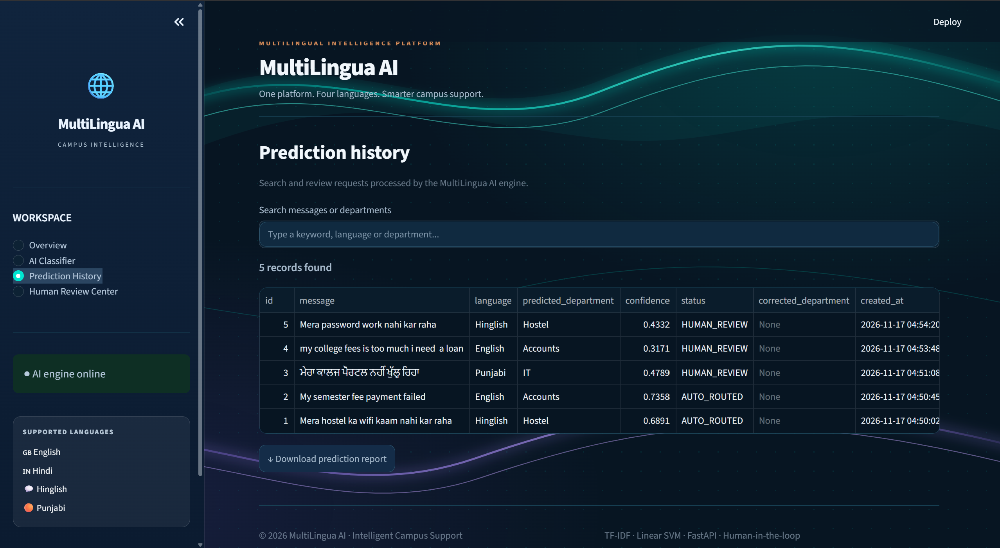
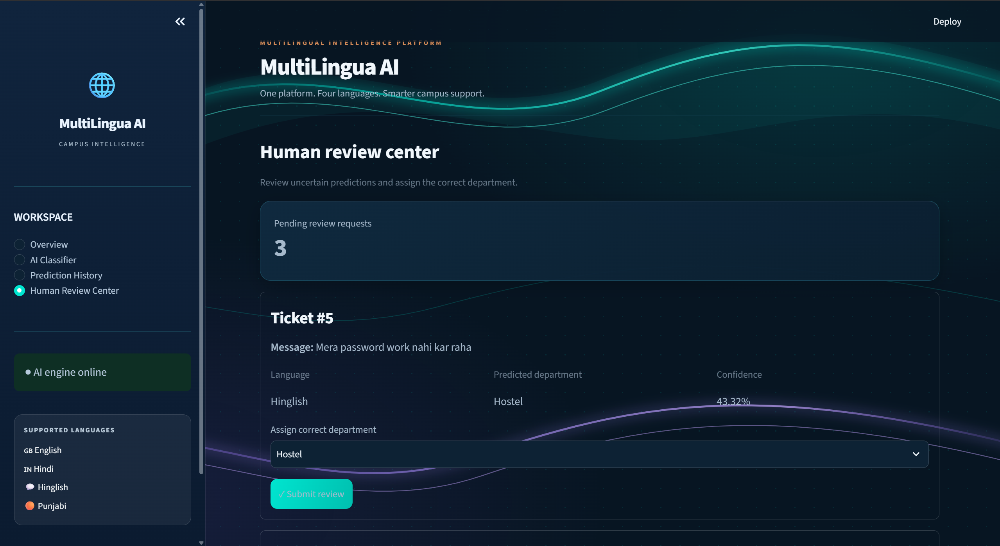

# 🌐 MultiLingua AI
### Intelligent Multilingual Campus Support & Query Routing System

MultiLingua AI is an intelligent campus support platform that helps students submit queries in multiple languages and automatically routes them to the appropriate university department using Machine Learning and Natural Language Processing.

The platform combines multilingual text classification, confidence-based routing, and a human-in-the-loop review mechanism to improve campus query management.

---

## ✨ Key Features

- **Multilingual Support:** Accepts queries in English, Hindi, Hinglish, and Punjabi.
- **Intelligent Classification:** Predicts the most relevant university department using a trained ML model.
- **Confidence-Based Routing:** Automatically routes high-confidence predictions while sending uncertain predictions for human review.
- **Human Review Center:** Allows administrators to review uncertain predictions and correct department assignments.
- **Prediction History:** Maintains a record of previously submitted queries and their outcomes.
- **Interactive Dashboard:** Displays prediction statistics, language distribution, department distribution, and routing activity.
- **REST API:** FastAPI backend for prediction and review operations.

## 🖥️ Dashboard Preview

The platform contains four main sections:

| Section | Description |
|---|---|
| Overview | Platform statistics and prediction analytics |
| AI Classifier | Submit multilingual queries and receive predictions |
| Prediction History | Explore previously processed queries |
| Human Review Center | Review and correct uncertain predictions |

### Screenshots

Add your four dashboard screenshots to `docs/screenshots/` using these filenames:









## 🧠 Machine Learning Architecture

The project uses a classical Machine Learning and NLP pipeline for multilingual query classification.

**Processing workflow:**

1. Student submits a query.
2. Text preprocessing and feature extraction are performed.
3. The trained classification model predicts the relevant department.
4. Prediction confidence is evaluated.
5. High-confidence predictions are automatically routed.
6. Low-confidence predictions are forwarded to the Human Review Center.
7. Human corrections can be recorded for review and further analysis.

The trained model is stored using Joblib.

## 🏢 Supported Languages

- English
- Hindi
- Hinglish
- Punjabi

## 🏛️ Supported Campus Departments

The classification system includes five campus department categories:

- Accounts
- Hostel
- IT
- [Add the remaining two department names from your dataset]

## 🛠️ Technology Stack

| Component | Technology |
|---|---|
| Programming Language | Python |
| Machine Learning | Scikit-learn |
| NLP | Text preprocessing and feature extraction |
| Model Storage | Joblib |
| Backend | FastAPI |
| Frontend | Streamlit |
| Database | SQLite |
| API Documentation | Swagger UI |
| Version Control | Git and GitHub |

## 📁 Project Structure

```text
MultiLingua-AI/
│
├── backend/
│   ├── main.py
│   ├── database.py
│   └── requirements.txt
│
├── frontend/
│   └── app.py
│
├── models/
│   └── multilingual_routing_system.joblib
│
├── data/
│   ├── raw/
│   └── processed/
│
├── docs/
│   └── screenshots/
│
├── .streamlit/
│   └── config.toml
│
├── .gitignore
└── README.md
```

## ⚙️ Installation and Setup

### 1. Clone the repository

```bash
git clone https://github.com/Yash-lead2005/MultiLingua-AI.git
cd MultiLingua-AI
```

### 2. Create a virtual environment

```bash
python -m venv venv
```

Activate it on Windows:

```powershell
.\venv\Scripts\Activate.ps1
```

### 3. Install dependencies

```bash
pip install -r backend/requirements.txt
```

### 4. Start the FastAPI backend

From the project root:

```bash
uvicorn backend.main:app --reload
```

Backend API:

```text
http://127.0.0.1:8000
```

Swagger API documentation:

```text
http://127.0.0.1:8000/docs
```

### 5. Start the Streamlit frontend

Open a second terminal from the project root:

```bash
streamlit run frontend/app.py
```

Frontend:

```text
http://localhost:8501
```

## 🔌 API Endpoints

| Method | Endpoint | Purpose |
|---|---|---|
| GET | `/` | API home |
| GET | `/health` | Backend health check |
| POST | `/predict` | Generate a prediction |
| GET | `/history` | Retrieve prediction history |
| GET | `/reviews` | Retrieve pending reviews |
| POST | `/review` | Submit a human review |

Interactive API documentation is available at `/docs`.

## 🔍 Project Objectives

- Improve accessibility of university support services.
- Reduce manual query classification.
- Enable multilingual communication.
- Improve routing decisions through confidence-based classification.
- Introduce human oversight for uncertain predictions.

## 🚀 Future Enhancements

- Improve multilingual classification performance.
- Expand the campus query dataset.
- Introduce model evaluation and monitoring dashboards.
- Add authentication and role-based administrator access.
- Implement continuous learning from verified human corrections.
- Deploy the platform for public access.

## 🔗 Project Links

| Resource | Link |
|---|---|
| 🌐 **Live Application** | [Launch MultiLingua AI](https://multilingua-ai-og5fzs6oedy6ilexh3xcty.streamlit.app/) |
| ⚙️ **Backend API** | [Backend Service](https://multilingua-ai-backend.onrender.com/) |
| 📘 **API Documentation** | [Swagger UI](https://multilingua-ai-backend.onrender.com/docs) |
| ❤️ **Backend Health Check** | [Check API Status](https://multilingua-ai-backend.onrender.com/health) |
| 💻 **GitHub Repository** | [Source Code](https://github.com/Yash-lead2005/MultiLingua-AI) |

### 🚀 How to Use

1. Open the Live Application link.
2. Enter a query in English, Hindi, Hinglish, or Punjabi.
3. Submit the query to get its predicted department and confidence score.
4. Explore prediction history and the human review workflow.

### 🛠️ Technology Stack

- **Frontend:** Streamlit
- **Backend:** FastAPI
- **Machine Learning:** Scikit-learn, TF-IDF, Linear SVM
- **Database:** SQLite
- **Deployment:** Streamlit Community Cloud and Render

## 👨‍💻 Author

**Yash Kumar**

Computer Science Engineering

GitHub: [@Yash-lead2005](https://github.com/Yash-lead2005)

---

*MultiLingua AI — One Platform. Multiple Languages. Smarter Campus Support.*
